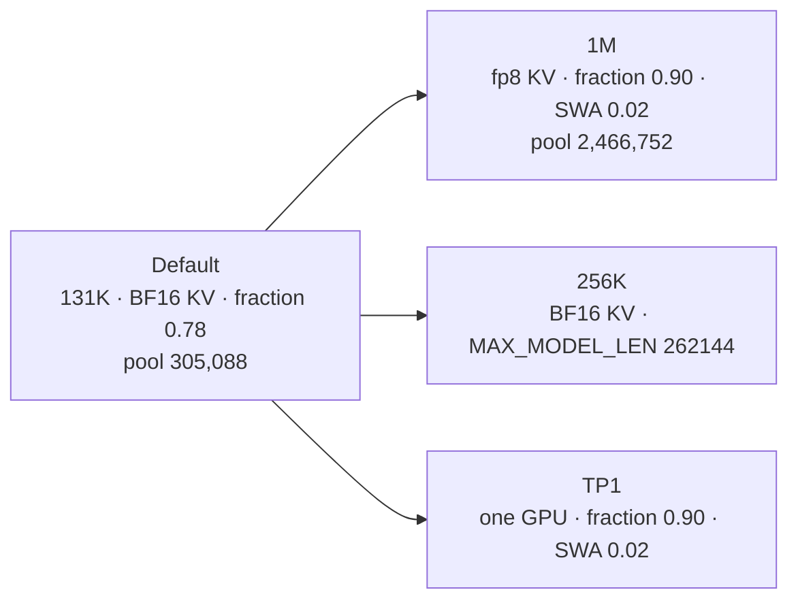

# Ripple-65B Preview, NVFP4, on two RTX PRO 6000

Serve the NVFP4 checkpoint of [Ripple-65B Preview](https://huggingface.co/ricursiveAI/Ripple-65B-Preview-NVFP4) with SGLang 0.5.19, tensor parallel 2, DFLASH speculative decoding at 32 draft tokens. NVFP4 covers the MLP layers; attention, embeddings, and the LM head stay BF16. Two NVIDIA RTX PRO 6000 Blackwell cards, 96 GB each.

```sh
export HF_HOME=/models_engrams/huggingface HF_HUB_CACHE=/models_engrams/huggingface/hub
hf download ricursiveAI/Ripple-65B-Preview-NVFP4 --revision 99eea4477a001a41b86914e41feb4b2ed86105e5
hf download ricursiveAI/Ripple-65B-Preview-DFlash2 --revision 35609b3be3dd08a822b3ba1257c1ea5dd6f87632

test -f .env || cp .env.example .env
./prepare.sh
./doctor.sh
./start.sh
curl http://127.0.0.1:30001/v1/chat/completions -H 'Content-Type: application/json' \
  -d '{"model":"ripple-65b-nvfp4","messages":[{"role":"user","content":"Hello"}],"max_tokens":128}'
```

`./smoke.sh --suite` runs the acceptance checks. `./bench.sh` measures throughput. `./stop.sh` stops. `./status.sh` and `./logs.sh` watch it.

## Settings

| Setting | Default | Meaning |
| --- | --- | --- |
| `MAX_MODEL_LEN` | 131072 | Per-request prompt plus output ceiling |
| `MEM_FRACTION_STATIC` | 0.78 | Weights and static share of each GPU; the rest is the KV pool |
| `KV_CACHE_DTYPE` | bfloat16 | `bfloat16` or `fp8_e4m3` |
| `SWA_RATIO` | engine 0.8 | Sliding-window pool as a fraction of the full pool |
| `NUM_DRAFT_TOKENS` | 32 | DFLASH speculative tokens per target forward |
| `GPUS` / `TP_SIZE` | 0,1 / 2 | GPUs and tensor parallel; TP divides 80 heads, so 1, 2, 4, 8 |
| `PORT` | 30001 | OpenAI-compatible API |

## Context options



| Profile | KV | Fraction | SWA | Pool tokens | Largest single request verified |
| --- | --- | --- | --- | --- | --- |
| Default 131K | bfloat16 | 0.78 | 0.8 | 305,088 | 114,725 |
| 1M | fp8_e4m3 | 0.90 | 0.02 | 2,466,752 | 787,537 |
| TP1, 128K | bfloat16 | 0.90 | 0.02 | 277,952 | 112,037 |

Run the 1M profile with
`KV_CACHE_DTYPE=fp8_e4m3 MAX_MODEL_LEN=1048576 MEM_FRACTION_STATIC=0.90 SWA_RATIO=0.02 ./start.sh restart`.

## Measured on this host

| Metric | Value |
| --- | --- |
| Decode, 3.6K and 32K prompts | 642 and 102 tok/s |
| Fresh prefill | ~4.2K tok/s |
| Custom agentic bench, 12 tasks | 12/12 |
| Quality gate, 20 prompts, BF16-KV | 20/20 |
| Quality gate, 20 prompts, fp8 1M | 19/20 |
| SWE-bench Verified, 10 instances | 9/10, 9/9 non-empty |
| Terminal-Bench 2.1, 10 tasks | 5/10, five timeouts |
| StrongREJECT | 98.31 |

## Notes

The engine story, memory math, benchmark receipts, and the tuning map live in the sibling planning repo, `ricursiveAI-2x-rtx6000pro-plan`, which is optional for running this recipe. Every number above has a receipt under `logs/`.
